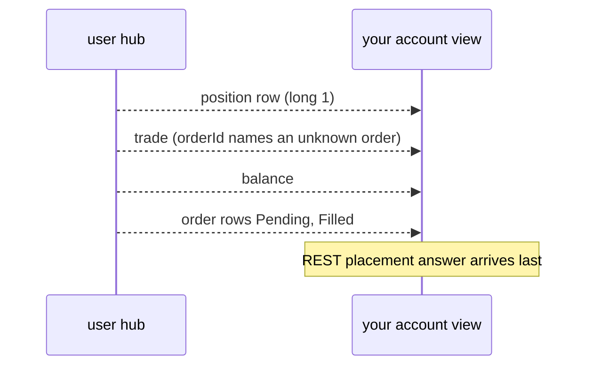

<!--
SPDX-FileCopyrightText: 2026 Kevin Monaghan
SPDX-License-Identifier: MIT-0
-->

# ProjectX behaviour guide

> What the ProjectX Gateway actually does when you use it through this
> client, written down so you do not have to find it out again.

## Who this is for

You are wrapping `projectx-client` inside a trading application: you keep an
account view, place and close orders, and must stay correct when the network
drops. The [README](../README.md) explains what the client guarantees. This
guide explains how the venue behaves around it: in what order rows arrive,
what each timestamp means, and where the gaps are.

Every fact carries one of these labels:

| Label | Meaning |
| --- | --- |
| Documented | Stated in the provider's published API docs or spec |
| Observed | Seen in live use, mostly in recorded practice sessions |
| Client | How this crate behaves, from its source |
| Reported | Told to us by an operator; not captured in a recording |
| Unverified | Plausible, but not proven either way |

The recorded sessions ran on simulated practice accounts in October 2026,
trading one or two micro index futures at a time. An observed fact shows
that something can happen. It does not promise that it always happens.
The dated 2026-10-26 observations below used `projectx-client` 7.0.0;
they extend the earlier recordings rather than proving a complete history.

## Connection

### Login and tokens

- Client: `authenticate()` logs in with a user name and API key.
  Authorized applications use `Client::application_builder`.
- Client: one token is shared by every clone of a `Client` and by the
  hubs it creates. Each hub connect and reconnect takes the latest token.
- Client: use `authenticate_with_validation` for long sessions. It
  renews the token in the background.
- Client: after HTTP 401 the token is unusable. The client does not log in
  again for you.

Client: REST logout and realtime disconnection are separate operations.
Await each owned hub's disconnect outcome and the REST logout outcome before
treating a login as retired. A missing local token or `NotAuthenticated`
alone is not a provider acknowledgement of logout; a refused or unconfirmed
outcome remains unresolved.

### One REST budget for almost everything

Documented, and enforced by the client:

| Requests | Budget |
| --- | --- |
| Bar history | 50 per 30 seconds |
| Every other authenticated call | 200 per 60 seconds |

The second budget is shared by reads, order placement, cancels, closes,
logout and session validation, on every clone of the client. Login and ping
are not counted.

Client: reads wait their turn, except the two exit reads described below.
Money-moving calls never wait. When the window is full, they fail at once
with `Error::LocallyRateLimited`, and nothing was sent.

> [!WARNING]
> A busy read loop can use the whole budget. A close or cancel sent next is
> then refused locally, at exactly the moment you need it. Reads queue;
> exits, the two exit reads included, do not.

### Reserving room for exits

Client: `RateLimitConfig::with_exit_reserve(n)` and
`Client::set_exit_reserve(n)` hold back `n` of the 200 requests. Only
`cancel_order`, `close_contract`, `partial_close_contract` and the two exit
reads, `search_open_positions_for_exit` and `query_orders_for_exit`, may use
them. Everything else stops at `200 - n`.

Client: the exit reads are for an exit that must learn what to close before
it can close it, such as a flatten of an account you have not read yet. They
are admitted like the exit mutations: they never wait, they are sent at most
once, and when the window is full they fail at once with
`Error::LocallyRateLimited`. A 429 on one is a plain
`Error::ProviderRateLimited`, since a read changes nothing at the venue. They
are not retried after a transport failure or a server error either. Size the
reserve for them too: one request for the position search plus one per page of
the order query, for each account an exit must read.

What worked for us:

- Start with the reserve already set, before the first read.
- Size it from what you might have to undo: one request per working order
  to cancel, plus one per account and contract with a position to close,
  plus the exit reads for any account you must read first.
- While anything is unknown (startup, a hub drop, an unanswered order),
  hold the full reserve. We used a cap of 50, which leaves 150 for
  ordinary work.
- Release it only when every account is known to be flat with no orders.

> [!IMPORTANT]
> The reserve shares the one rolling window. Raising it cannot recover
> requests already spent, and it does not bypass a provider 429 cooldown.
> Separate `Client` instances and separate processes do not share a
> budget, even with the same login.

### Two hubs

Documented: there are two SignalR hubs. The market hub carries quotes,
trades and depth. The user hub carries account, order, position and trade
rows for the accounts you subscribe.

- Client: when a socket fails, the client reconnects about every five
  seconds for as long as you have asked it to stay connected.
- Client: it keeps no subscriptions. After `RealtimeEvent::Reconnected`,
  send every subscription again.
- Observed: rows missed while a hub was down are not replayed. Two
  recorded sessions cut both hubs while a position was closed. In the first,
  the closing trade never arrived on the stream; a later REST trade search
  had it.
- Observed: in the second, a `close_contract` sent during the outage
  answered success over REST. A second `close_contract` on the contract,
  answered 0.5 s after the first with the hubs still down, was refused
  with code 2 (`PositionNotFound`). The first close's order, fill and flat
  position row were never pushed, in the 17 s the capture ran after the
  user hub returned. Nothing on the stream said the position was gone: the
  refusal was the first sign, and a REST position read about 15 s after the
  first close showed it flat. The order and position reads after the
  reconnect all came back empty; no trade read was recorded.
- Observed (practice, 2026-10-27, client 7.0.0): with both hub connections
  cut and held down, `cancel_order` returned successfully for one unfilled
  limit order. Separate open-order and position reads were empty before
  reconnection was released.
- Observed: after a reconnect, the trade that opened a lot can be pushed
  again when the lot closes (see [Fills](#fills-fees-and-pnl)).

Treat `Disconnected` and `TransportGap` as "my view may be stale". Read
orders, positions and trades over REST before you trust the account again.

### When the venue ends your session

- Observed: opening a second full session (REST and hubs) for the same user
  made the venue push `GatewayLogout` to the first session's user hub about
  two seconds later.
  Its message begins "Multiple sessions detected".
- Observed: after that notice, the first session's REST reads still worked,
  its market hub still delivered, and orders were still accepted for at
  least 70 seconds.
- Observed: two REST logins of the same user ran side by side for 90
  seconds without either being logged out.
- Unverified: how long the venue keeps serving after `GatewayLogout`.

Reported (configured practice setup, 2026-10-29): only one active login is
permitted. Frontend and SDK sessions must therefore be sequential. The older
concurrency observations above record what happened in those sessions; they
do not establish permission for this setup or general support for concurrent
applications.

Our advice: treat the notice as final. Keep watching, allow only cancels
and closes, and ask a person to reconnect.

### Ambiguous outcomes

Client: a mutation that may have reached the venue, but whose answer is
unclear, returns `Error::AmbiguousMutation`. Timeouts, HTTP 429 after
sending, and "pending" or "unknown" codes all count. The client never
retries it. Read venue state before you decide what to do.

Client: the error's text names the operation and the evidence, for example
`position close outcome is ambiguous (code: 6 OrderPending); reconcile
provider state before retrying`. A request refused before sending reads
`local general rate limit is exhausted; retry after 60s`, with the time left
in the window.

## Data

### Contracts

- Documented: contract ids look like `CON.F.US.MNQ.Z26`: product root, month
  code, two-digit year.
- Observed: some roots differ from the exchange's own. Examples: `EP` is
  `ES`, `ENQ` is `NQ`, `GCE` is `GC`, `EU6` is `6E`. Keep a mapping table.
- Documented: `activeContract` marks the front month on each row. Nothing
  promises exactly one active row per product.
- Documented: contract search returns at most 20 rows.
- Observed: `contract_by_id` also finds months no longer in the available
  list.
- Observed: for pricing, a contract row gives only tick size and tick value.
- Observed: every account row said `simulated: true`, evaluation accounts
  included. You cannot tell practice from evaluation by that flag.
- Observed (2026-10-26): the raw `/api/Account/search` rows carried a
  balance but no currency field. A currency chosen by an integration is not
  a currency stated by that response.

### Bars and history

- Documented: one reply holds at most 20,000 bars. Treat a full reply as
  possibly cut short; we keep each request just under that many intervals.
- Observed: a bar is stamped with the instant its window opens. A
  one-minute bar stamped 22:00:00Z holds 22:00 to 22:01.
- Observed: bars longer than one hour start at the session open, not on
  clock hours. Build those from one-hour bars or smaller.
- Observed: daily, weekly and monthly bars start at a session open, such as
  the Sunday evening open for CME Globex products.
- Client: `include_partial_bar(true)` adds the forming bar.
- Observed: the forming bar's values can include trades after the end you
  asked for.
- Unverified: `BarUnit::Tick`. We used aggregated bars only.

### Trade history

- Client: `search_trades` needs a start time; the end is optional.
  `query_trades` can leave out both, which asks for every trade available.
- Documented: there is no paging, count or cursor. Retention is not stated.
- Observed: in one sample the reply listed the newest trade first. Sort by
  time and id yourself.
- Observed: a trade list read just before a position read missed a trade
  that the position already included. Reading the trades again found it.

### Live market data

- Client: market rows arrive in batches. Read the contract from the frame
  (`invocation.contract_id()`) and decode with `decode_batch`. The rows
  inside name the product symbol, not the month.
- Documented: trade prints carry no trade id, so you cannot de-duplicate
  them by id. The print's type gives the aggressor side.
- Client: quotes are sparse updates. A missing field means "not in this
  update", never zero. Merge them per contract.
- Documented: quotes carry best bid and ask prices but no sizes.
- Documented: depth rows give a price level's resting size. Zero means the
  level is gone. A reset row clears the book. There is no stated level
  count and no opening snapshot. After a reconnect, clear your book and
  rebuild it.

### Timestamps

No row carries a sequence number. Use ids to match rows, not times.

| Row | Field | What it means |
| --- | --- | --- |
| Trade | `creationTimestamp` | When it executed |
| Order | `creationTimestamp` | When the order was created |
| Order | `updateTimestamp` | The order's latest change |
| Position | `creationTimestamp` | When the position opened |
| Account | none | Balance rows have no time |
| REST reply | none | Order answers have no venue time |

> [!IMPORTANT]
> A position row's `creationTimestamp` is its opening instant. Observed:
> it names the same instant on every later row, including the flat row, to
> the microsecond (see below), and in one reversal it stayed the same while
> the side flipped. It cannot tell you how fresh the row is, or order it
> against trades.

Observed (practice, 2026-10-26, client 7.0.0): two user-hub rows for the
same closing order carried exactly the same native `updateTimestamp`, but
different state:

| Arrival order | `status` | `fillVolume` |
| --- | --- | --- |
| First | 6 (`Pending`) | 0 |
| Second | 2 (`Filled`) | 1 |

Both arrived while one REST order query was in flight. An order's
`updateTimestamp` is therefore not a unique revision or a safe deduplication
key. Preserve arrival order and the full row. This sample does not establish
which hub row a concurrent REST result reflects, or that taking the last
arriving row resolves that ambiguity.

Observed: precision varies by channel and by row.

- Hub rows carry up to seven decimal places (100 ns). Trailing zeros are
  dropped, so a stamp can show fewer: some first pushes have six digits,
  and some later rows five.
- REST trade search cuts times to the microsecond, so a trade's REST time
  can be slightly earlier than its hub time. We saw 400 ns and 900 ns.
- A restated trade (action 1) can carry the coarser time too.
- Other rows restating an earlier instant are cut the same way: a
  position's `creationTimestamp` on every row after its first push, hub and
  REST alike (`05:42:40.5409089` became `05:42:40.540908`), and an order's
  on some later rows (`12:04:55.5494686` became `12:04:55.549468`).
- A cut drops the digits past the sixth, it does not round, so the value
  itself changes, by up to 900 ns.

Compare instants using the precision relation established for their sources.
For the recorded REST/hub truncation, compare the higher-precision instant at
the REST value's precision. Two decodings of the same original payload should
retain the same exact instant; do not truncate every timestamp
indiscriminately. Compare decimal prices by value rather than their trailing
zeros.

## Execution

### Order types

| Code | Type | Notes |
| --- | --- | --- |
| 1 | Limit | Observed |
| 2 | Market | Observed |
| 3 | Stop-limit | Decoded only; see below |
| 4 | Stop (stop-market) | Observed |
| 5 | Trailing stop | Documented; not observed |
| 6 | Join bid | Documented; not observed |
| 7 | Join ask | Documented; not observed |

- Client: type 3 decodes when the venue reports one. `PlaceOrder::builder`
  and `Bracket::new` refuse it, because the placement docs do not list it
  as a request value.
- Documented: the OpenAPI spec lists type 3. Unverified: whether the venue
  accepts it.
- Client: trailing placement and modification accept an absolute
  `trail_price`; order reads expose a distance there. Request Decimal fields
  serialize as JSON numbers. A quoted decimal in a decoded or re-encoded
  representation does not change that request contract (see the README).
- Unverified: join orders are placed without a price and rest at the best
  bid or ask. We have no recording of one.
- Client: there is no time-in-force field. Every order is good till
  cancelled.
- Documented: modify changes only size and prices. It cannot change type,
  side, contract or duration.

### The order lifecycle on the user hub

Observed:

- User-hub rows come wrapped with an `action` field beside the row data.
- Order rows are always action 1.
- A market order goes `Pending` then `Filled`, with no `Open` row.
- A resting limit or stop shows `Open`.
- A modify is pushed as a new `Open` row with the new size and prices. The
  REST answer carries no terms.
- A cancel is pushed as a `Cancelled` row, usually before the REST answer.
- The placement answer can come before or after the hub rows; usually after.
- A hub `Rejected` row has no message. Only the REST refusal carries the
  venue's words. The REST answer has no venue time, so you cannot order the
  two by time.
- `customTag` must be unique per account. Orders placed elsewhere, and the
  orders behind `close_contract` and `partial_close_contract`, have none.
- Trades carry no tag. Match a trade to its order by `orderId`.

### What arrives first

Observed, on the user hub:

- The order row, trade, position row and balance usually arrive in that
  order, within a few milliseconds.
- In a fast burst, a position row and its trade came before any order row
  naming the order. The placement answer came last.
- A position row can lead its trade, the flat row included: one flat row
  came 0.38 ms before its closing trade. The worst lead we saw was 0.46 ms,
  an entry row.
- Position rows mostly trail their trade, by 0.3 to 11 ms in a burst.
- A balance can be pushed before the trade it includes.
- A balance can repeat an older figure after a newer trade. The right
  figure followed about 1.3 ms later.
- The same balance is often pushed twice.

Our advice: hold a fill you cannot match until its order row arrives. Hold
a position row that your fills have not reached yet. Wait a few seconds of
quiet before calling any difference a mismatch; we wait 5 seconds.

### Fills, fees and PnL

Observed:

- A trade with action 0 is a new fill. Action 1 restates an older trade:
  the trade that opened a lot is pushed again when the lot closes, even in
  a session that never saw it. Never book action 1 as a fill.
- Also de-duplicate by trade id, scoped by account.
- `fees` and `commissions` are separate fields. The balance is charged
  both, so add them. One sample, from one practice account: a
  two-contract MNQ fill stated `fees` 0.72 and `commissions` 0.50, 1.22 in
  all. Fee schedules can differ between accounts.
- `profitAndLoss` is set on a trade that closes a position and empty on
  one that opens it.
- One order can fill as several trades at one price: a reversal as a
  closing trade with PnL and an opening trade without; a two-lot exit as one
  trade per lot. They can arrive in any order, within about half a
  millisecond.
- Documented: trades carry a `voided` flag. Observed: no trade was ever
  voided in our sessions.

### Positions

Observed:

- `size` is a quantity, not a signed number. `type` 1 is long and 2 is
  short.
- A held position is action 1. Going flat pushes action 2 with size 0 and
  type 0. That flat row still carries an `averagePrice`; ignore it.
- A reversal (long 1, sell 2) produced one position row, short 1, after
  both trades. The row kept its id and opening time.
- `creationTimestamp` names the same opening instant on every row of the
  position, but its precision varies (see [Timestamps](#timestamps)).
- After a first-in-first-out partial exit, `averagePrice` is the remaining
  lot's own entry price. `partial_close_contract` gave the same figure:
  when it left one of two lots bought together, `averagePrice` stayed at the
  entry price.
- A new position after flat gets a new position id.

### Closing positions

- Client: `close_contract` closes the whole position; `partial_close_contract`
  closes a given size. Both use the exit reserve.
- Observed: each close is carried out as a market order without a tag.
- Observed: `close_contract` leaves working orders working, resting exits
  and bracket legs included (see [Brackets](#brackets)). Cancel them
  yourself.
- Observed: `close_contract` on a flat contract answers code 2
  (`PositionNotFound`) with `errorMessage` null and pushes nothing.
- Observed: code 2 also answers a close whose position an earlier close
  emptied during a hub outage (see [Two hubs](#two-hubs)).
- Observed: a close and a partial close each answer success with no order
  id. Match the close order by account, contract and time.
- Observed: the close's untagged order row, its fill and the flat or reduced
  position can all arrive on the user hub before the REST answer.

| Code | `close_contract` | `partial_close_contract` |
| --- | --- | --- |
| 1 `AccountNotFound`, 2 `PositionNotFound`, 3 `ContractNotFound`, 4 `ContractNotActive` | Refused | Refused |
| 5 | `OrderRejected`, refused | `InvalidCloseSize`, refused, also for a size above the position |
| 6 | `OrderPending`, ambiguous | `OrderRejected`, refused |
| 7 | `UnknownError`, ambiguous | `OrderPending`, ambiguous |
| 8 | `AccountRejected`, refused | `UnknownError`, ambiguous |
| 9 | Undocumented, ambiguous | `AccountRejected`, refused |

Client: a refused code is `Error::Provider`; an ambiguous one is
`Error::AmbiguousMutation`.

A flatten that worked for us: cancel every working order, including
suspended bracket children, then close every position. Send each group at
once.

### Refusals we have seen

| Request | Answer |
| --- | --- |
| Modify a filled order | Code 3, "Order not found" |
| Cancel an unknown order id | Code 2, `errorMessage` null |
| Cancel a filled order | Code 5 (ambiguous) |
| Place with a reused `customTag` | Code 2, "custom tag ... unique" |
| Place with size 0 | Code 2, "Invalid order size" |
| Place an off-tick limit | Code 2, but an order is created |
| Long bracket with a positive stop | Code 2, but an order is created |

Observed (practice, 2026-10-27, client 7.0.0): MNQ and MES market orders
returned code 2 `OrderRejected`: "Trading is currently unavailable. The
instrument is not in an active trading status." The hub reported `Pending`
then `Rejected`, with zero fill volume. The preceding contract rows had
`activeContract: true`, and the account row had `canTrade: true`. Those flags
did not establish that the venue would accept orders.

The off-tick refusal also creates an order that the hub reports as
`Rejected`. Its id never means a working order.

Code 5 on a cancel is `UnknownError`. The client reports it as
`AmbiguousMutation`, so read the order before deciding.

### Brackets

- Documented: attaching stop or target legs requires the account's Auto
  OCO Brackets setting. In Position Brackets mode the order is refused with
  code 2, yet a rejected order is created with an id. No endpoint tells you
  the mode; ask the account owner.
- Documented: one stop leg and one target leg at most, each given in ticks.
  Legs have no size field and no price field.
- Observed: ticks are signed against the entry. A long's stop is negative
  and its target positive; a short is the reverse.
- Observed: legs wait as `Suspended` orders, with no prices, until the
  parent fills. Then they are measured from the fill price.
- Documented: `search_open_orders` leaves out suspended orders. Use
  `query_orders` with `Open`, `Pending`, `PendingCancellation` and
  `Suspended`, and read every page.
- Observed: hub rows for legs carry `parentOrderId`, and some carry
  `linkedOrderId`.
- Observed: a one-tick edit to an active stop leg was accepted in both
  directions.
- Observed: cancelling an unfilled parent cancelled its legs. A later cancel
  of a leg answered code 5.
- Observed: with the client disconnected, a target filled and the venue
  cancelled the sibling stop. Brackets run at the venue.
- Observed: an Auto OCO entry that filled kept its target and stop `Open`
  after `close_contract` closed the position. Both legs stayed working on
  every order read for about 11 seconds, until the caller cancelled them.
- Unverified: whether the venue ends a bracket's legs when the position goes
  flat another way (an opposite market order, `partial_close_contract` down
  to zero, a close from another session), and what a leg left working does
  if price reaches it. Only `close_contract` was recorded.
- Unverified: what legs do when the parent fills only in part.

### Copier follower accounts

- Documented: cancellation works only for simulated accounts that are not
  copy-trading followers. Others get code 6 (`AccountRejected`).
- Reported: accounts that follow a venue-hosted copier reject direct
  orders and flatten requests.
- Client: the account row has no field that marks a follower.

Our advice: let the user declare follower accounts. Keep watching them,
send them no orders, and leave them out of your exit reserve. Their reads
still use the shared REST budget.

## Wrapping the SDK

Client: typed REST results retain the fields modelled by the SDK, not unknown
response fields or original JSON formatting. Re-encoding a DTO is not raw
HTTP capture. `ProviderList::Absent` combines omitted and null list fields.
Realtime invocation payload and entity access retain their original JSON;
decoding through `serde_json::Value` can lose numeric-token precision, so use
raw-token typed decoding when that distinction matters.

A short checklist from what we learned:

1. Build one `Client` per login and share its clones. Separate clients do
   not share the rate budget.
2. Set the exit reserve before the first request. Keep it full while
   anything is unknown.
3. Never retry a mutation on your own. On `AmbiguousMutation`, read first.
4. Scope every venue id (order, trade, position) by account.
5. Accept rows in any order: hold unmatched fills and early positions.
6. Ignore trades with action 1, and de-duplicate trades by id.
7. Add `fees` and `commissions` together for the full charge.
8. Use `query_orders` with suspended orders included, never
   `search_open_orders` alone.
9. When a bracketed position goes flat any way but its own legs, read the
   orders and cancel the legs still working. The venue does not end them.
10. After any `Disconnected`, `Reconnected` or `TransportGap`, subscribe
    again and read orders, positions and trades over REST. Missed rows are
    never replayed: a close that REST answered during the gap can leave no
    trace on the stream.
11. Read trades, then positions, then trades again. If the two trade lists
    differ, read again. Separate REST calls are not one snapshot.
12. Treat `ProviderList::Absent` as "unknown", never as "empty".
13. If an order row has terms you cannot use (an unknown type, a leg with no
    price), keep its id so you can still cancel it. Keep the rest of the
    snapshot.
14. Treat `GatewayLogout` as the end of the session.

## Known gaps

These are limits of the venue or of our evidence, not promises.

| Gap | Status |
| --- | --- |
| Sequence number or resume point on hub rows | None exists |
| Atomic snapshot across accounts, orders, positions | Not offered |
| Trade search paging, retention, completeness | Not stated |
| Ids unique across accounts | Not stated |
| Margin on the user hub; a daily PnL figure | Not offered |
| Rate limit for hub invocations | Not published |
| Live samples of types 3, 5, 6 and 7 | Not observed |
| A resting order filled in parts over time | Not seen |
| A voided trade | Not seen |
| Bracket legs on a partly filled parent | Not stated |
| Bracket legs after another way of going flat | Not seen |
| Service after `GatewayLogout` | Not stated |
| Copier follower rejection | Reported, not observed |
| History with `BarUnit::Tick` | Not tested |
